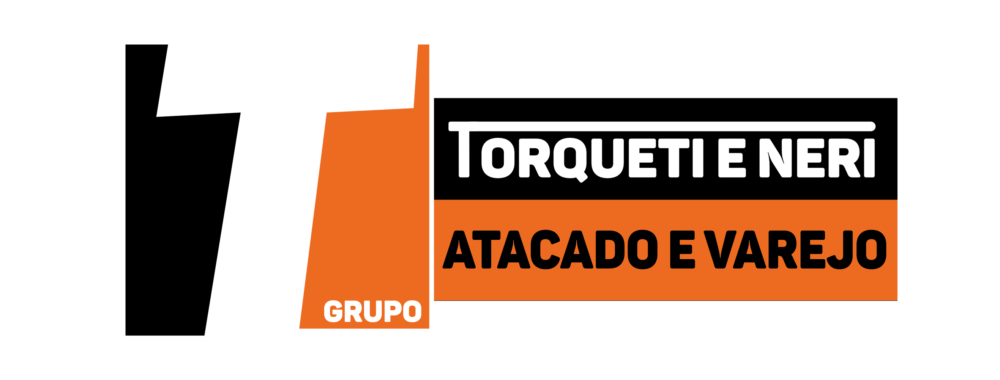

# TORQUETI E NERI SUPERMERCADOS — Downloads

Aplicativo de suporte remoto da empresa, baseado no RustDesk Open Source, com servidor próprio já configurado e atendimento por **ID e clique em Aceitar**.

**Os instaladores estão em compilação.** Esta página receberá os links diretos de Windows 64 bits, Mac Apple Silicon e Mac Intel assim que os arquivos estiverem disponíveis. Ainda não há instaladores publicados.

Não será necessário criar uma conta no GitHub para baixar. O download livre não autoriza acesso ao computador: cada atendimento exige o aceite da pessoa atendida.

A distribuição incluirá o código-fonte correspondente e checksums SHA-256. Licença GNU AGPL v3 em [LICENCE](LICENCE). Base: [RustDesk](https://github.com/rustdesk/rustdesk). A logo e a marca da empresa pertencem aos respectivos titulares.
